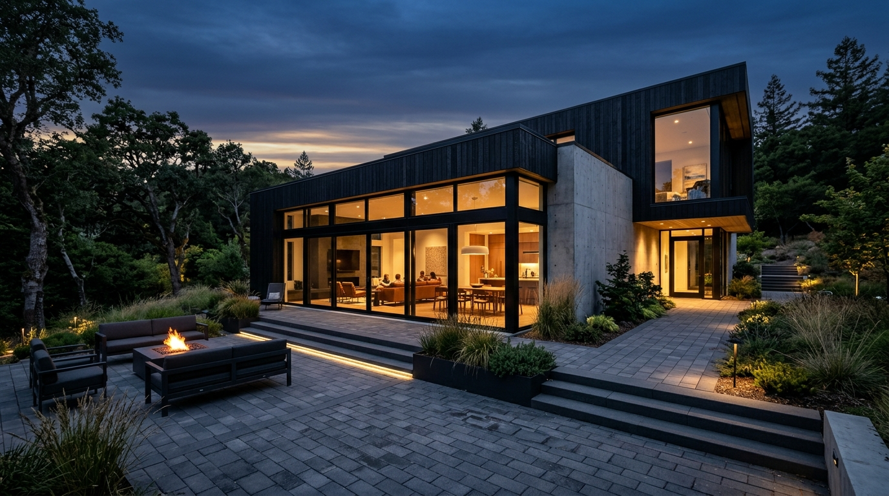

# Roshani Enterprises Goa: Coastal Precast Concrete & Infrastructure

A 1:1 architectural and visual replica of the **NextState** landing page concept from Pinterest ([Pin 992058624187135541](https://in.pinterest.com/pin/992058624187135541/)), precision-engineered for **Roshani Enterprises** (Sancoale / Zuarinagar, South Goa, India), adhering strictly to **Together AI's Hallmark design rules**, **Silk-Design motion guidelines**, and **Landing Page Design conversion principles**.



## Client Research & Authentic Business Grounding

Roshani Enterprises is a certified precast concrete manufacturing firm established in **2014** by **Arif Khan** in the **Sancoale Industrial Area / Zuarinagar (Vasco da Gama & Chicalim region), South Goa, India (403726)**.

### Verified Product Portfolio
1. **Interlocking Paver Blocks**: High-density hydraulically compacted pavers (Yellow Milano, Fan Blade, I-Shape, Cosmic, and Hexagonal profiles) in 60mm, 80mm, and 100mm heavy-axle freight grades (IS 15658 certified).
2. **Precast Boundary & Compound Walls**: Reinforced concrete wall panels and columns (IS 456 & IS 13920 seismic/wind-rated) providing rapid 150m/day installation for villa communities and industrial parks.
3. **Heavy-Duty RCC Manhole Covers & Drainage**: Round, square, and rectangular covers rated for heavy industrial and highway axle loads (HD 20T and EHD 35T per IS 12592).
4. **Architectural Concrete & Civil Utilities**: Designer cement jalis for tropical ventilation, concrete garden benches, window grills, and solid RCC foundation blocks.

---

## 1:1 Pinterest Architecture & Sections

The layout mirrors the exact structure, proportions, and visual hierarchy of the Pinterest reference:

1. **Floating Header**: Dark pill navbar with brand emblem, multi-link navigation with accessible dropdown (`Home`, `Products ▾`, `About facility`, `Goa projects`), right-docked `Contact us` pill, and direct circular arrow button `→`.
2. **Hero Stage (Large Dark Container)**:
   - Deep architectural slate container with bottom rounded corners (`44px` radius).
   - High-impact 3-line display headline in uppercase: *“BUILDING COASTAL FOUNDATIONS WITH ENGINEERED PRECAST”*.
   - Left column with 10-word punchy description, `Play videos` yard tour CTA, and social proof avatar stack (*12+ years satisfied clients in Goa*).
   - Right column architectural visual featuring contemporary coastal concrete villa with illuminated twilight interior and stone paver courtyard.
   - Overlaid rotating circular stamp badge (*“roshani enterprises • tested for coastal goa •”* with `↗` arrow).
   - Floating pill badge at bottom right (*“70+ new molds ready”*).
3. **Section 2: "About Us" / Trust in Excellence**:
   - Light coastal sky ground (`var(--color-page-bg)`).
   - Two-line headline (*“Trust in excellence, believe in home. Your enduring infrastructure awaits with Roshani Enterprises.”*).
   - Left column: Tall vertical coastal villa architecture card with `rounded-3xl` container.
   - Right column: 3 stat counters side-by-side (`35K+ sqm paved`, `40K+ units ready`, `10K+ meters sold`), company background narrative, and `Start inquiring today` action pill.
4. **Section 3: "Direct Inquiry" Consultation Card**:
   - Elevated pure white container with smooth `32px` rounded corners and soft elevation.
   - Left: Clear heading (*“Your coastal project demands strength. Chat with our precast specialists for free guidance today.”*), consultation narrative, and primary action button (`Contact us today`).
   - Right: Studio cutout portrait of civil engineering consultant Arif Khan holding an architectural building model, gracefully overlapping the card.
5. **Section 4: "Explore Products" (3-Card Showcase)**:
   - Header with section title, coastal resilience narrative, and contact action.
   - 3 Feature Cards with varied column widths:
     - **Card 1 (Dark Active Featured Card)**: Charcoal/navy card matching the reference’s *Harmony Haven* card, with `New` chip, `Contact us` pill, circular arrow `→`, 3-row specification box, and technical description.
     - **Card 2 (Light Card)**: Precast Boundary Walls with top media frame, floating circular arrow button, title, and `View more` pill.
     - **Card 3 (Light Card)**: Heavy Duty RCC Manholes with civil drainage media frame, floating circular arrow button, title, and `View more` pill.
6. **Mandatory B11 Tagline Reveal Section**:
   - Minimalist, scroll-illuminated typography reveal: *“Precast concrete engineered for coastal Goa. Built to endure fifty monsoons without cracking.”*
7. **Section 5: "Subscribe to Our Newsletter" Skyline Banner**:
   - Dark, dramatic full-width rounded card banner with upward-angle skyscraper architecture and silhouette birds against blue sky.
   - White pill input bar with dark `Subscribe` button and real-time confirmation feedback.
8. **Section 6: Clean Light Two-Column Footer**:
   - Left: *“Looking to buy, sell or invest in real estate?”* lead, requirement search bar pill with circular arrow button `→`, and social links (Facebook, X, Instagram, YouTube, WhatsApp).
   - Right: Quick navigation links, brand emblem, and authentic Sancoale Industrial Area address block.
9. **Interactive Dialogs & Drawers**:
   - Accessible video tour `<dialog>` with realistic yard manufacturing preview.
   - Quick factory quote modal with product selection and field validation.
   - Slide-over product specification drawer with complete IS-code technical specifications.

---

## Design System & Hallmark Sloplint Standards

- **Tokens Over Literals**: 100% of colors, shadows, radii, and spacings defined in `tokens.css` using OKLCH color spaces. Zero hardcoded hex values across components.
- **Strict 4px Spacing Scale**: All layout padding, margins, and gaps adhere strictly to the scale (`--spacing-0` through `--spacing-1050`).
- **Typography Hierarchy**: Set exclusively in *Manrope* (`400`, `500`, `600`, `700`) as specified in Landing Page Design B1.
- **Motion & Deceleration**: Weighted compositor curve `cubic-bezier(0.22, 1, 0.36, 1)` animating strictly `transform` and `opacity` with `@media (prefers-reduced-motion: reduce)` fallbacks.
- **Sloplint Verification**: Audited with Hallmark's `sloplint.mjs`:
  ```bash
  sloplint: clean. 0 FAIL, 0 REFLEX, 0 WARN across 4 file(s).
  ```

---

## File Structure

```
roshanienterprises/
├── index.html        # Complete semantic HTML matching Pinterest reference 1:1
├── style.css         # Component and layout styles with Hallmark stamp
├── tokens.css        # OKLCH color tokens, type scale, and spacing tokens
├── base.css          # Reset, container, and accessibility primitives
├── main.js           # Scroll reveal, interactive modals, drawer, and form logic
├── assets/           # Curated & generated high-resolution architectural assets
│   ├── hero-villa.jpg           # Contemporary concrete villa at dusk
│   ├── about-house.jpg          # Tall coastal residence with slate siding
│   ├── consultant.png           # Transparent cutout of consultant holding model
│   ├── product-walls.jpg        # Precast boundary wall installation
│   ├── product-drainage.jpg     # Civil concrete drainage infrastructure
│   ├── newsletter-skyline.jpg   # Skyscraper skyline with silhouette birds
│   └── avatar-[1-5].jpg         # Client profile avatars for social proof stack
└── README.md
```

## Local Preview

Preview the website locally using Python 3:

```bash
python3 -m http.server 8080 --directory /home/certified_tech_idiot/coding/roshanienterprises
```

Navigate to `http://localhost:8080` in any web browser.
